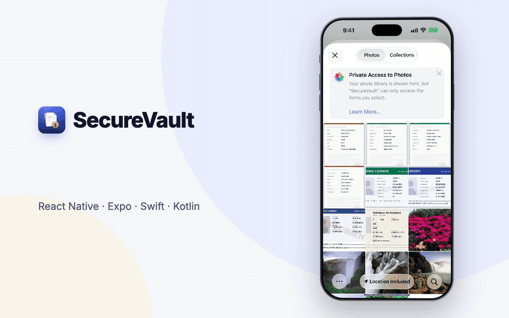
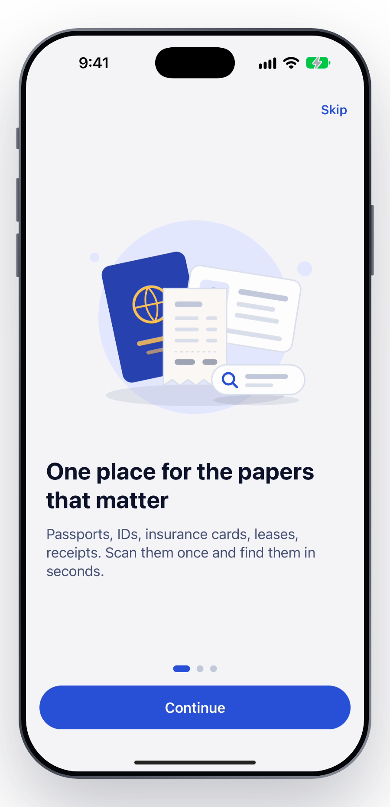
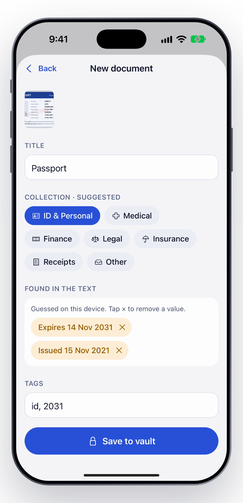
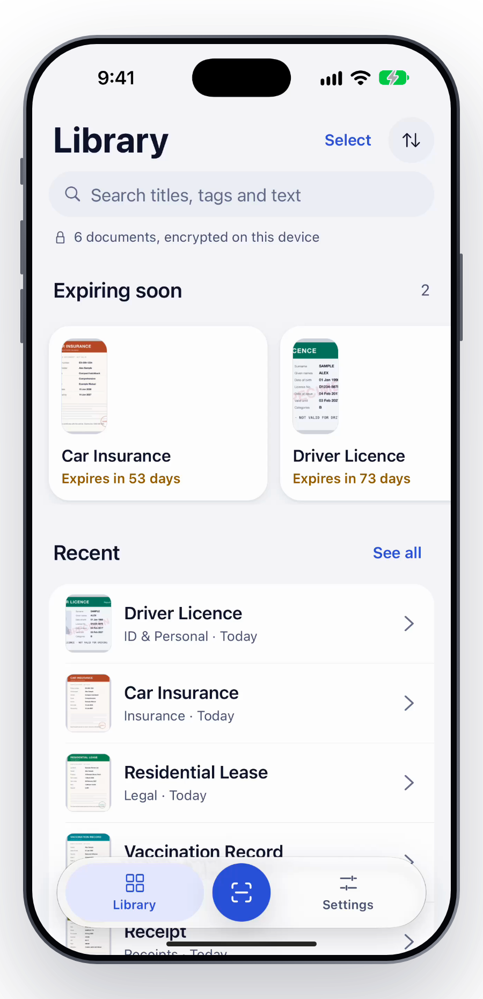
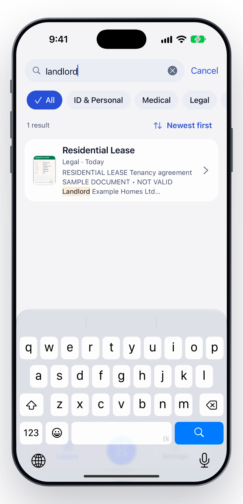
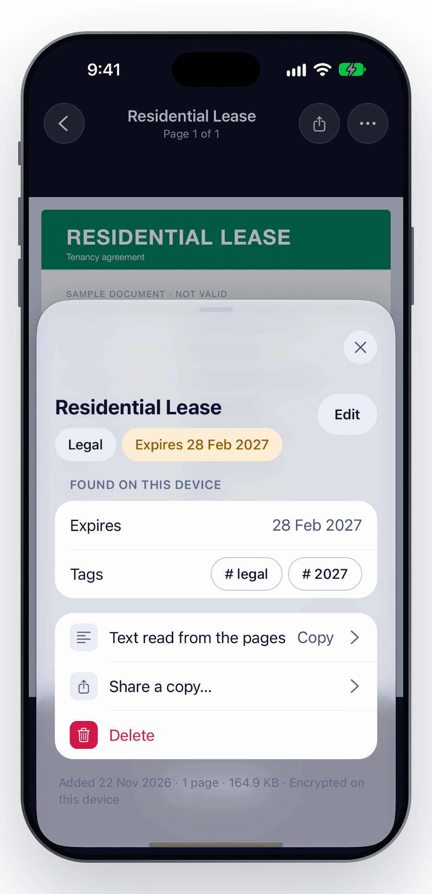
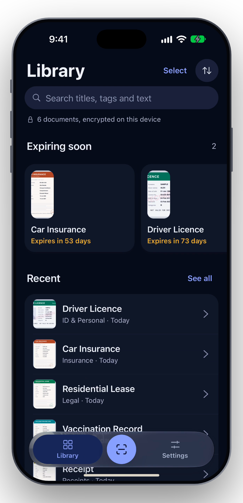
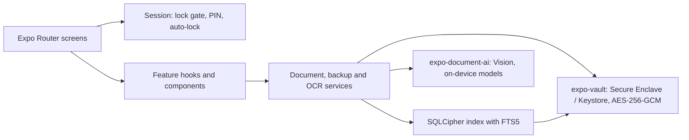

# SecureVault

**A private document vault for your phone: scan a passport, a lease or a receipt once, and find it in seconds — encrypted on the device, on iPhone and Android.**

SecureVault is a portfolio project by [Nadir Alfakesh](https://naderalfakesh.com):
one person taking a product from design to a tested, working app. Every
document shown here is a fictional sample; it is not a published product.

<p align="center">
  
</p>

<p align="center">
  <a href="docs/securevault-promo.mp4"><strong>▶ Watch the 84-second walkthrough with sound</strong></a>
</p>

## At a glance

- **A complete product, not a screen mock-up.** Set-up, scanning and import,
  search, a page viewer, sharing, backup and settings all work end to end.
- **Private by design.** There is no account and no server. Documents are
  encrypted on the phone and open only with Face ID, a fingerprint or a PIN.
- **It reads the page for you.** Add a document and the app suggests its
  title, its collection and its dates, and warns you before something expires.
- **Find anything.** Search looks inside the documents, not only at their
  names.
- **Tested like production software.** More than 1,100 automated tests run on
  every change, plus separate tests for the encryption code on each platform.
- **One codebase, two platforms.** The same React Native code ships to iOS and
  Android, with native Swift and Kotlin where security needs it.

## Screens

| Welcome                                                                                                                 | Suggested details                                                                                                                                       | Library                                                                                                                  |
| ----------------------------------------------------------------------------------------------------------------------- | ------------------------------------------------------------------------------------------------------------------------------------------------------- | ------------------------------------------------------------------------------------------------------------------------ |
|  |  |  |

| Search inside documents                                                                                                          | Details found on the device                                                                                                              | Dark mode                                                                                     |
| -------------------------------------------------------------------------------------------------------------------------------- | ---------------------------------------------------------------------------------------------------------------------------------------- | --------------------------------------------------------------------------------------------- |
|  |  |  |

## What you can do in it

- **Set it up in a minute** — a short intro, a 6-digit PIN, then Face ID,
  Touch ID or a fingerprint. Repeated wrong PINs lock the keypad for longer
  each time.
- **Add documents** — scan with the camera (several pages at once), take a
  photo, or import a photo or a PDF.
- **Let it fill in the details** — the text is read on the phone, and a
  title, a collection, tags, dates and numbers are suggested for you to accept
  or change.
- **Find and view** — full-text search, collections, an "Expiring soon" row,
  and a pinch-to-zoom page viewer.
- **Share safely** — send a copy under the document's own name, optionally
  after a second Face ID check, and undo a delete.
- **Back it up** — one passphrase-protected backup file that restores on
  either platform.
- **Make it yours** — light, dark or automatic, auto-lock timing, and a
  privacy cover that hides the vault in the app switcher and blocks screenshots.

## How it is built

For engineers: the short version of what is under the hood.

| Area       | Choice                                                                                       |
| ---------- | -------------------------------------------------------------------------------------------- |
| App        | React Native 0.88, React 19.3, Expo SDK 58, TypeScript 6 (strict), React Compiler            |
| Navigation | Expo Router with typed routes and `Stack.Protected` guards around the lock gate              |
| UI         | Unistyles 3 with light and dark themes and a small accessible design system                  |
| Native     | Three local Expo Modules in Swift and Kotlin: the vault, the document scanner, document AI   |
| Storage    | expo-sqlite with SQLCipher and FTS5 for the index; encrypted files in the vault module       |
| Crypto     | AES-256-GCM in 1 MiB chunks; PBKDF2-HMAC-SHA256 for the PIN and backup keys                  |
| Text       | Apple Vision (iOS) and ML Kit (Android), with Foundation Models or Gemini Nano where present |
| Quality    | Jest, React Native Testing Library, XCTest, JUnit with Robolectric, ESLint, Prettier         |



Decisions worth a look:

- **The key never leaves secure hardware's protection.** On iOS a random key
  is sealed to a Secure Enclave key, so only this iPhone can open the vault
  and only after Face ID, Touch ID or the passcode; on Android a
  non-exportable Keystore key does the same job
  ([ADR 0009](docs/adr/0009-hardware-bound-device-key.md)).
- **Search without a plaintext index.** Titles, tags and extracted text live
  in SQLCipher with FTS5; the index key is stored encrypted under the device
  key ([ADR 0002](docs/adr/0002-encrypted-sqlite-index-and-key-hierarchy.md)).
- **Suggestions that cannot invent facts.** Where the phone has an on-device
  language model it proposes the details, and every date and number must
  appear in the scanned text before the form shows it; elsewhere text patterns
  do the job ([ADR 0008](docs/adr/0008-on-device-language-models.md)).
- **No Google code on iOS.** Apple Vision reads text there
  ([ADR 0011](docs/adr/0011-apple-vision-text-recognition-on-ios.md)).
  Android uses ML Kit, which sends Google usage metrics but not images or
  text; [docs/SECURITY.md](docs/SECURITY.md) says so plainly.
- **Backups that fail safely.** A `.svbackup` file is checked in full before
  the restore touches the vault; a wrong passphrase or a damaged file changes
  nothing ([ADR 0007](docs/adr/0007-passphrase-protected-backup-container.md)).
- **Accessible by default.** Dynamic Type up to 2×, 44 pt touch targets,
  screen-reader labels and reduced-motion handling in the design system.

**Tests:** `npm run validate` runs formatting, lint, strict type checks,
144 Jest suites with 1,128 tests and Expo Doctor. The Jest suites run the real
repository against SQLite with FTS5. The vault module's Swift and Kotlin code
has its own tests (21 XCTest and 25 JUnit cases) that read shared test
vectors written by an independent Node implementation of the file formats, so
each platform is checked against bytes neither app wrote. CI runs all of it
on every push to `main` and every pull request. More in the [security model](docs/SECURITY.md), the
[modernization plan](docs/MODERNIZATION_PLAN.md), the
[architecture decisions](docs/adr/) and the
[verification notes](docs/verification/).

[](https://github.com/naderalfakesh/secure-vault/actions/workflows/ci.yml)
[](https://github.com/naderalfakesh/secure-vault/actions/workflows/native-tests.yml)

```text
app/                     Expo Router routes: lock, setup, tabs, documents, settings
src/screens/             One folder per screen: components, hooks, helpers
src/components/ui/       Accessible design-system primitives
src/features/            Session, auth, documents, scan, backup, viewer
src/services/            Document, backup and OCR services
src/data/                SQLCipher index: schema, migrations, repository
modules/expo-vault/      Swift and Kotlin vault: keys, encrypted files, PDF pages, backups
modules/expo-document-scanner/  VisionKit and ML Kit scanner
modules/expo-document-ai/       Apple Vision text reading and on-device models
docs/                    Plan, security model, ADRs, verification notes
```

## Run it locally

Nothing to sign up for: the app has no backend.

```sh
npm install
npx expo prebuild --clean
npm run ios        # or: npm run android
```

<details>
<summary>Prerequisites, simulator notes and commands</summary>

- Node.js 24 (`.nvmrc`) and npm.
- iOS: Xcode 27 with CocoaPods. Pick a simulator with
  `npm run ios -- --device "<simulator name>"`.
- Android: Android Studio with an SDK and a JDK 17 or 21. Point `JAVA_HOME`
  at one of those; the JDK 25 that recent Android Studio builds bundle fails
  the Gradle prefab step.
- Expo Go is not supported; the app needs a development build for its native
  modules.

On the iOS simulator, enrol Face ID under Features before the first unlock.
The simulator has no camera, so the scan and photo rows are disabled there
and documents come from Photos or Files. On the Android emulator, set a
screen lock first (`adb shell locksettings set-pin 1234`) because the vault
key requires one.

| Command                           | Purpose                                                    |
| --------------------------------- | ---------------------------------------------------------- |
| `npm start`                       | Start Metro for the development client                     |
| `npm run ios` / `npm run android` | Generate and run a native build                            |
| `npm test`                        | Run the Jest suites                                        |
| `npm run test:native:ios`         | Run the vault's Swift tests on the Mac (`swift test`)      |
| `npm run test:native:android`     | Run the vault's Kotlin tests (after `expo prebuild`)       |
| `npm run validate`                | Run formatting, lint, strict types, tests, and Expo Doctor |

</details>

## Background

SecureVault began in 2025 as an Expo SDK 53 prototype, preserved under the
[`legacy-v1`](https://github.com/naderalfakesh/secure-vault/tree/legacy-v1)
tag. This version is a full rebuild in nine phases with a new interface; it
kept the prototype's one good idea, a small Swift and Kotlin vault module
with a platform-protected key. The
[legacy baseline](docs/verification/legacy-baseline.md) records the original
audit. The Android release build has been tested on a Pixel 9
([device note](docs/verification/device-pixel9-android.md)); a pass on a
physical iPhone is still to do.

## License

[MIT](LICENSE). Contributions follow [CONTRIBUTING.md](CONTRIBUTING.md).
