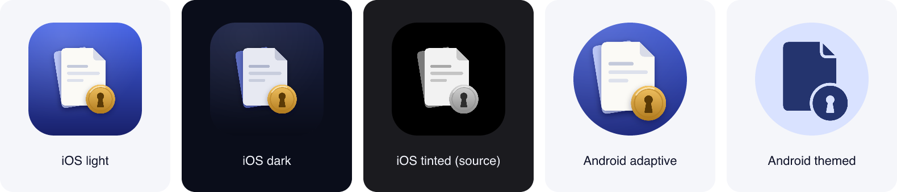

# App icon, splash, and onboarding illustrations

> Verified: 2026-11-17 (host: `npm run validate`; Android Release build on
> the Android 16 emulator, fresh install; iOS not run, see "Owed")
>
> Base: `main` at `21a3f51`.

## What changed

- A new mark, the sealed folio: a sheet of paper closed with a brass seal,
  on the indigo tile. It replaces the outline document-and-padlock glyph.
- `src/brand/folio.ts` holds the drawing as SVG markup. `npm run
assets:icons` (`scripts/brand/make-icons.mjs`, `@resvg/resvg-js`) renders
  every PNG in `assets/` from it, and the in-app `Mark` draws the same SVG
  with `SvgXml`, so the splash handoff repaints the native splash exactly.
- Icons: iOS light, dark (night tile) and tinted (grayscale on black);
  Android adaptive foreground, a gradient background image, and a themed
  (monochrome) silhouette with the seal set apart.
- Splash: the 138 pt mark (the image is 150 wide, the tile 92 % of it), so
  it stays inside Android 12+'s 192 dp circular crop. `SPLASH_MARK` follows.
- Onboarding: each slide draws a scene in the icon's style
  (`OnboardingArt`): a passport, an ID card, a receipt and a search; a page
  turned to ciphertext inside the phone, closed with the seal; the unlock
  frame with a face, a fingerprint or the screen-lock keypad (from the
  device's biometry), the seal and the PIN as backup. Two layers rise in on
  first show; with Reduce Motion they fade. The art is hidden from assistive
  tech; titles and bodies carry the meaning.
- Jest ignores `.claude/` worktrees, which held a second copy of the app.

## Checks

| Check                             | Result                                         |
| --------------------------------- | ---------------------------------------------- |
| `npm run validate`                | Green: 92 suites, 907 tests, Expo Doctor 20/20 |
| Android `assembleRelease` (arm64) | `BUILD SUCCESSFUL` after `expo prebuild`       |

## Device runs

| Run                                | Result                                                                                                                                                                                                                                                                                               |
| ---------------------------------- | ---------------------------------------------------------------------------------------------------------------------------------------------------------------------------------------------------------------------------------------------------------------------------------------------------- |
| Android 16 emulator, fresh install | The splash shows the new mark centred on the light background; the three slides draw their scenes ([1](../images/onboarding-1-android.png), [2](../images/onboarding-2-android.png), [3](../images/onboarding-3-android.png)). The emulator has no fingerprint enrolled, so slide 3 shows the keypad |
| Android 16 emulator, app drawer    | The adaptive icon fills the circle mask like its neighbours, inside the safe zone                                                                                                                                                                                                                    |

## Owed

- iOS: the light, dark and tinted icons on the Home Screen, the splash and
  its handoff, and slide 3 with the Face ID glyph, on the iOS 27 simulator.
- Android 12+ on a phone with a fingerprint: slide 3 with the fingerprint
  glyph, and the themed icon with Material You on.
